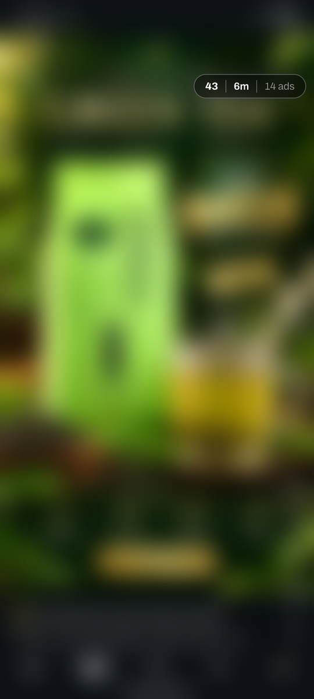
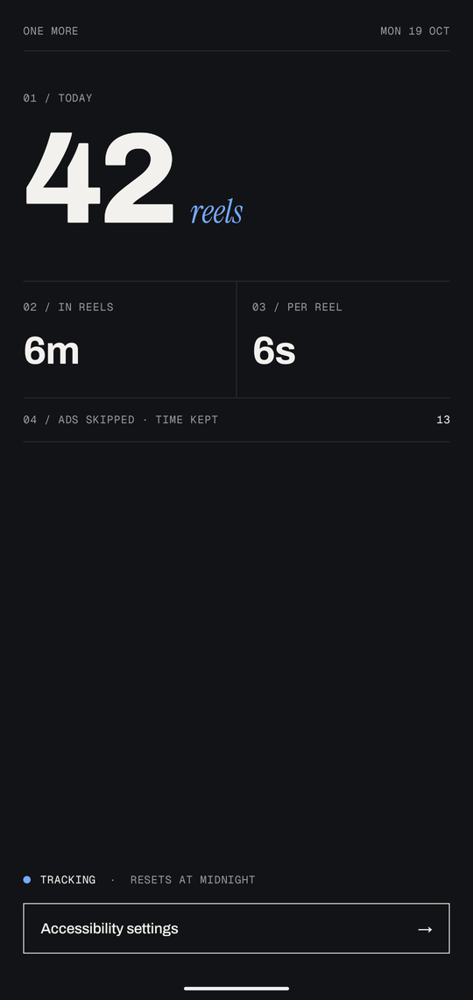

# One More

**How many Instagram Reels did you actually watch today?**

One More is a tiny Android app that counts your Reels and the time you spend on them, and keeps the number in a small bubble on screen while you scroll.

<p align="center">
  
  &nbsp;&nbsp;
  
</p>

## What it counts

- **Reels:** a reel counts once it has been on screen for 2 seconds. Quick skips don't count, and scrolling back to a reel doesn't count it twice.
- **Time:** only time spent in the Reels viewer counts. The clock stops when the screen is off.
- **Ads:** sponsored reels get their own count and are left out of your reel count. Their time still counts, because you were still scrolling.
- Everything resets at midnight.

## Install

You need an Android phone (8.0 or newer) and a computer with the Android SDK and JDK 17.

```sh
./gradlew assembleDebug
adb install app/build/outputs/apk/debug/app-debug.apk
```

Then open **One More**, tap **Accessibility settings**, and turn on One More.

> On Android 13 and newer, sideloaded apps can't use accessibility at first. Go to **App info → ⋮ → Allow restricted settings**, then try again.

## How it works

One More uses Android's accessibility service. It watches for Instagram's Reels viewer and reads which reel is showing from Instagram's scroll events. The bubble is an accessibility overlay, so the app doesn't need permission to draw over other apps.

**Privacy:** it has no internet permission. Your stats live only in the app's own storage on your phone, and nothing leaves the phone.

## Heads up

- **It depends on Instagram's internals.** It recognises the Reels viewer by an internal view ID (`clips_viewer_view_pager`) and ads by their "Ad" label. An Instagram update can break either one. The values are constants at the bottom of [`ReelService.kt`](app/src/main/java/dev/galib/rotcounter/ReelService.kt).
- **Returning to Instagram counts the current reel again.** The app tracks reels by their position in the feed, and that restarts each time you open Reels.
- It's Android only. iOS doesn't let apps see or draw over other apps.

## Development

```sh
./gradlew test     # unit tests for the counting rules
adb logcat -s OneMore   # debug builds log scroll events and each count
```
